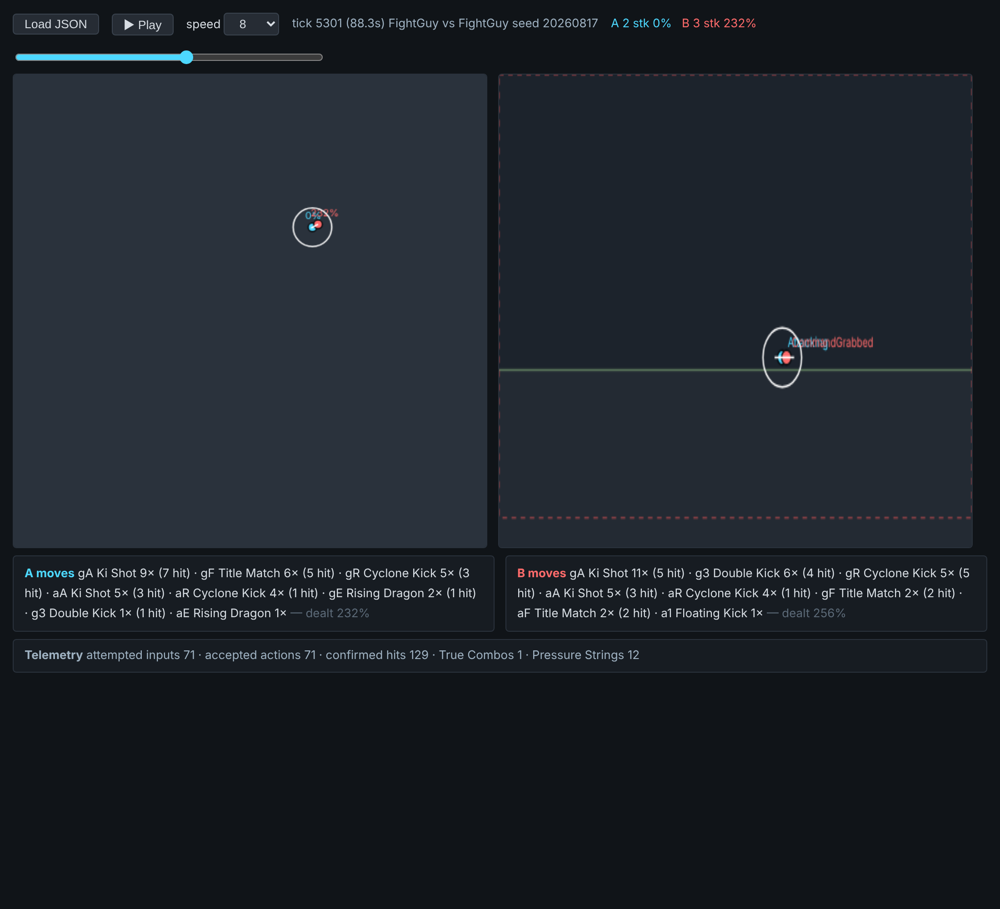
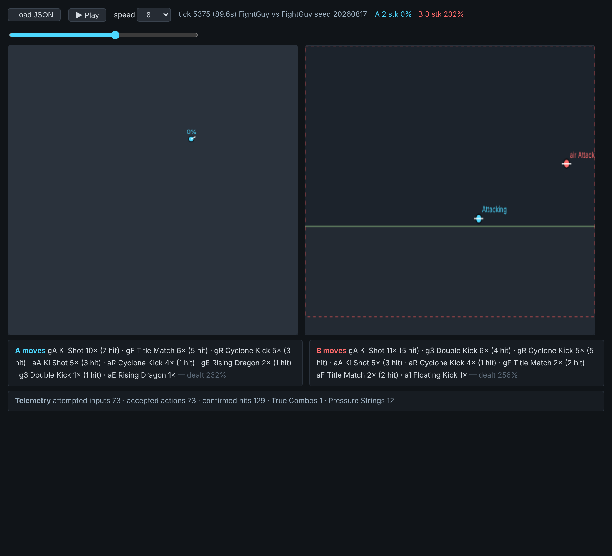

# Phase 1 status: foundation import and combat-loop check

Base: upstream [Binoui/SLOPArena](https://github.com/Binoui/SLOPArena) `main` at
`714d9f8b` (MIT), imported with full history. No gameplay code was changed.

## What works from a plain clone (no Unity needed)

Requires the .NET 8 SDK (and Python 3 for the browser viewers).

```bash
dotnet build SlopArena.sln --nologo -p:SkipUnityPluginCopy=true      # 0 errors
dotnet test  SlopArena.sln --no-build --nologo -p:SkipUnityPluginCopy=true

# Live terminal view of two CPU fighters (Ctrl+C quits)
dotnet run --project tools/SpectateView -p:SkipUnityPluginCopy=true -- --char fightguy

# Headless match + JSON dump, then open tools/SpectateView/viewer.html and "Load JSON"
dotnet run --project tools/SpectateView -p:SkipUnityPluginCopy=true -- --char fightguy --speed 0 --json match.json
```

Verified on Linux with .NET 8.0.133:

- The solution builds with 0 errors and 99 analyzer warnings.
- The combat test subset passes, 163 of 163 (`--filter` on CombatMath, CombatPipeline, Knockback, CombatTuning and Hitbox).
- The full `dotnet test` run is very long. It was stopped after 30 minutes in the cloud session, so it has not been confirmed end to end.

### Combat loop confirmed

A headless FightGuy-vs-FightGuy CPU match (seed 20260817, 3 stocks) using the real
`ServerSimulation`:

- 249 confirmed hits, about 916% total damage dealt, 4 KOs. Every KO is credited
  to an attacker. B wins after 158 s.
- Damage builds up. Example: target at 0% is hit by Ki Shot, goes to 6%, and is pushed 2.8 m.
- Hits that land at higher damage launch the target higher. For hits of 5% or more,
  the median peak height within 0.5 s is 1.5 m below 40%, 2.5 m between 40% and 100%,
  and 3.1 m at 100% or more.
- Ring-out: B is grabbed at 232%, thrown, and flies in hitstun from x=17 to x=37 m
  and from y=5 to y=10 m. B is removed past the x=40 blast line at tick 5400 and
  respawns at (12, 0.8) with 0%.
- The Bonk-vs-Bonk match also ran: 137 hits and 4 KOs.

Screenshots from the replay viewer. The left panel is the top-down view and the right panel is the side view; the dashed red line is the blast zone.

| Grab at 232% (tick 5301) | Launch toward the blast zone (tick 5375) |
| --- | --- |
|  |  |

## What is missing for the full Unity project

`python3 tools/check_unity_setup.py` fails on a clean clone. It reports:

| Missing input | Why | What it blocks |
| --- | --- | --- |
| **Animancer** (`Packages/com.kybernetik.animancer`, 8.4.0) | Paid Kybernetik package, git-ignored | Client compile: 8 scripts have `using Animancer` |
| **104 catalog asset GUIDs** (FightGuy, Manki, Wibou, Bonk) | Rigs, clips, materials and VFX come from paid or private packs and are git-ignored | Fighter models and animations in the editor |
| Stage art, audio, some UI/VFX, shield VFX | Paid packs (JustCreate, Cartoon FX, Shield Shader, ...) | Stage visuals, sound, hit effects |
| `SlopArena.Shared.dll` in the Unity plugins folder | Generated file | Fixed by `dotnet build src/Shared/ --nologo` with Unity closed |

Required editor version: **Unity 6000.0.78f1**. The upstream docs say a fresh clone
"can't open the full game yet". The maintainer can share a private asset bundle
(`tools/unity_asset_bundle.py`); otherwise the paid packs and Animancer would need
to be bought and re-imported. See `docs/contributing/unity-setup.md` and
`docs/assets/contributor-inputs.md`.
